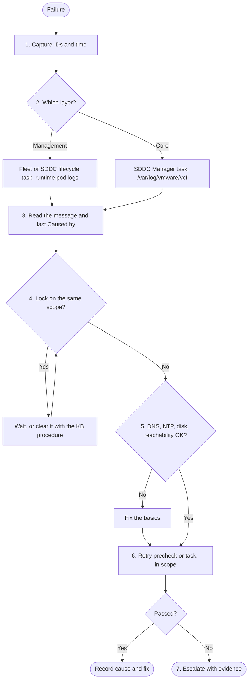

<InShort>
1. **Capture the IDs**: reference ID or task ID, and the time to the minute.
2. **Find the layer** that owns the failure: a management component or the core infrastructure.
3. **Read the message** and the resolution text in the task details.
4. **Check for locks**: nothing else running on the same scope.
5. **Check the basics**: DNS, NTP, disk, reachability.
6. **Recover in scope**: retry the precheck or the task, not the whole workflow.
7. **Escalate with evidence**: bundle, IDs, timestamps and what was tried.

The order matters more than the content. Steps 1 to 5 take minutes. They usually find the cause, or at least make step 7 short.
</InShort>

<Compare rows={[
  ["Where tasks live", "SDDC Manager Tasks panel", "SDDC Manager for domain work. VCF Operations Build > Lifecycle for fleet and 9.1 SDDC lifecycle."],
  ["Error format", "Enum codes and a reference token", "Also VCF_LCM_... codes with a reference ID, and VCFMS- or VCFA- prefixed precheck codes"],
  ["Logs", "/var/log/vmware/vcf/ on SDDC Manager", "The same, plus runtime pods and VCF Operations under /storage/log/vcops/log/"],
  ["Retry", "UI retry or PATCH /v1/tasks/{id}", "The same. Fleet tasks retry from the failed step."],
]} />

## The method as a flow



## 1. Capture the IDs

Before touching anything, copy the task ID, the reference ID or token, the failed subtask name and the exact time, with its time zone. SDDC Manager and installer logs are in UTC. Every later step uses these to search logs, and support asks for them first.

## 2. Find the layer

<Diagram viewBox="0 0 760 220" label="Two layers, two lifecycles" caption="Ask which layer owns the failing object. The answer picks the UI, the log and the retry method.">
  <rect class="box v9" x="20" y="20" width="340" height="180" rx="10"/>
  <text class="t" x="190" y="48" text-anchor="middle">Management components</text>
  <text class="s" x="190" y="76" text-anchor="middle">VCF Operations, Automation, identity broker,</text>
  <text class="s" x="190" y="96" text-anchor="middle">Ops for networks, log management, runtime</text>
  <text class="s" x="190" y="130" text-anchor="middle">Driven by fleet lifecycle</text>
  <text class="s" x="190" y="150" text-anchor="middle">Logs: runtime pods, VCF Operations</text>
  <text class="s" x="190" y="170" text-anchor="middle">UI: Build > Lifecycle > VCF Management</text>
  <rect class="box accent" x="400" y="20" width="340" height="180" rx="10"/>
  <text class="t" x="570" y="48" text-anchor="middle">Core infrastructure</text>
  <text class="s" x="570" y="76" text-anchor="middle">vCenter, ESX, NSX Manager and Edges, vSAN,</text>
  <text class="s" x="570" y="96" text-anchor="middle">SDDC Manager itself</text>
  <text class="s" x="570" y="130" text-anchor="middle">Driven by SDDC lifecycle and SDDC Manager</text>
  <text class="s" x="570" y="150" text-anchor="middle">Logs: /var/log/vmware/vcf/ on SDDC Manager</text>
  <text class="s" x="570" y="170" text-anchor="middle">UI: Build > Lifecycle > VCF Instances</text>
</Diagram>

Error prefixes help: `VCFMS-` points at the services runtime, `VCFA-` at VCF Automation, and an `IAM_401_INVALID_TOKEN` usually at time sync.

## 3. Read the message

Open the failed subtask and read the whole message, including the resolution text. Many 9.x errors say exactly what to fix. Then open the matching log and find the exception's **last "Caused by"**. See [reading SDDC Manager logs](/vcf/library/troubleshooting/reading-sddc-manager-logs/).

## 4. Check for locks

Is anything else running on the same domain, host or component: a precheck, a backup, a password rotation? `sos --health-check` lists active locks (<KB id={439473} />). Don't start a second operation on the same scope. See [stuck tasks and locks](/vcf/library/day-2/stuck-tasks-locks/).

## 5. Check the basics

- **DNS:** forward and reverse, lowercase, from the component that failed.
- **NTP:** drift causes token errors such as "JWT token is expired" (<KB id={409353} />).
- **Disk:** on SDDC Manager, vCenter, VCF Operations and the runtime.
- **Reachability:** from the address that makes the call. In 9.1 that is often a runtime node.

The DNS part is quick to script. This read-only check runs from any Linux shell, including SDDC Manager. It flags a missing forward or reverse record, a reverse record that points at a different name, and mixed-case names.

<Download file="/downloads/vcf/vcf-check-basics.sh" title="vcf-check-basics.sh" description="Read-only DNS and reachability pre-flight for a list of VCF FQDNs. Changes nothing." license="MIT" source />

```bash
# hosts.txt: one FQDN per line
./vcf-check-basics.sh -p hosts.txt
```

## 6. Recover in scope

Fix the cause, then retry the smallest thing: **Retry Precheck**, **Retry Task**, or the API. Fleet tasks resume from the failed step. For a stuck 9.1 lifecycle task, use the supported service script (<KB id={435569} />). Don't redeploy to retry, and don't delete runtime VMs.

## 7. Escalate with evidence

| Attach | How |
|---|---|
| Core bundle | `sos --sddc-manager-logs --zip`, or `--collect-all-logs` (<KB id={385749} />) |
| Management services (9.1) | Add `--vcf-mgmt-svcs-logs`, or the fleet lifecycle bundle. If fleet lifecycle is down, the standalone script (<KB id={444466} />). |
| VCF Operations | Control Panel > Support Bundles (<KB id={443789} />) |
| UI problems | A browser HAR file |
| Always | Task and reference IDs, time of failure, and what you tried since |

<Callout type="field">
Write the seven steps into the ticket template as headings. It makes junior engineers faster, it makes handovers between shifts painless, and it gives the support engineer everything in the first message.
</Callout>

## Rules that hold everywhere

- Snapshot before any database change.
- One operation at a time on a given scope.
- Health before retry. Retry before rebuild.
- During upgrades, check the order first (<KB id={440630} />). Many "errors" are a step done too early.
