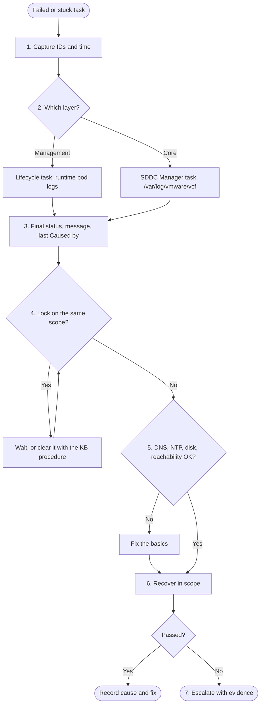

<InShort>
Use this order when a VCF task or lifecycle operation has failed or stalled. If no task sits behind the symptom, as with a slow VM or lost connectivity, start in VCF Operations Workbench instead, which is [what Broadcom's 9.1 Troubleshooting Blueprint recommends](https://techdocs.broadcom.com/us/en/vmware-cis/vcf/vcf-9-0-and-later/9-1/design/design-blueprints-for/infrastructure-modernization/troubleshooting-guide/troubleshooting-methods.html).

1. **Capture the IDs**: task ID, reference code, the time with its offset, and what changed beforehand.
2. **Find the layer** that owns the failure: a management component or the core infrastructure.
3. **Read the message**: the task's final status first, then the error and its resolution text.
4. **Check for locks**: nothing else running on the same scope.
5. **Check the basics**: DNS, NTP, disk, reachability.
6. **Recover in scope**: retry what failed, and restart a service only if a stuck task calls for it.
7. **Escalate with evidence**: bundle, IDs, timestamps and what was tried.

Even when steps 1 to 5 miss the cause, they make step 7 short.
</InShort>

<Callout type="note" title="Corrected on 7 November 2026">
This note used to say fleet tasks resume from the failed step, that all SDDC Manager and installer logs are in UTC, that `VCFMS-` and `VCFA-` prefixes identify a layer, that `IAM_401_INVALID_TOKEN` can point at time sync, that errors carry `VCF_LCM_` codes, that `sos --health-check` lists locks on every release, and that drift in general raises "JWT token is expired". Those claims are removed or narrowed below to what Broadcom publishes, and the "supported service script" is now the script attached to KB 435569.
</Callout>

<Compare rows={[
  ["Where tasks live", "SDDC Manager Tasks panel", "SDDC Manager for domain work. On 9.1, VCF Operations: Build > Tasks > VCF Instances, and Build > Lifecycle > VCF Management for fleet and SDDC lifecycle."],
  ["Error format", "errorCode and referenceToken in the API error object", "The same object, a Reference Code on 9.1 lifecycle steps, and VCFMS- codes on management services checks"],
  ["Logs", "/var/log/vmware/vcf/ on SDDC Manager", "The same, plus lifecycle pods on the services runtime and /storage/log/vcops/log/ on VCF Operations (<a href='https://knowledge.broadcom.com/external/article/440982' target='_blank' rel='noopener'>KB 440982</a>)"],
  ["Retry", "UI Retry or PATCH /v1/tasks/{id}, failed tasks only", "The same on SDDC Manager, except credential tasks. Some fleet lifecycle tasks also retry on their own."],
]} />

<Callout type="analysis" title="When the task isn't the starting point">
[Broadcom's blueprint](https://techdocs.broadcom.com/us/en/vmware-cis/vcf/vcf-9-0-and-later/9-1/design/design-blueprints-for/infrastructure-modernization/troubleshooting-guide/troubleshooting-methods.html) recommends Workbench "for all incidents of significance": start from the impacted object and the exact time window, review recent changes, read the Potential Evidence tab, and open logs last. This note goes to the task and its log first, which runs against that order, and the reason is scope. The [blueprint's four scenarios](https://techdocs.broadcom.com/us/en/vmware-cis/vcf/vcf-9-0-and-later/9-1/design/design-blueprints-for/infrastructure-modernization/troubleshooting-guide/troubleshooting-scenarios.html) are workload performance, connectivity, intermittent problems and reboots, and none is a lifecycle failure, where the failed task already gives the object, the time and the error. So follow the blueprint when no task failed, and this order when one did. Workbench depends on [VCF Operations, Log Management, VCF Operations for Networks and real-time data](https://techdocs.broadcom.com/us/en/vmware-cis/vcf/vcf-9-0-and-later/9-1/design/design-blueprints-for/infrastructure-modernization/troubleshooting-guide/environment.html) being installed before the incident, which makes it a design-time decision.
</Callout>

## The method as a flow



## 1. Capture the IDs

Before touching anything, copy the task ID, the failed subtask name, the exact time with its offset, and the reference code. The API's reference token [correlates the error with its detailed logs](https://developer.broadcom.com/xapis/vmware-cloud-foundation-api/latest/v1/tasks/id/patch/) and belongs in the case; 9.1 lifecycle steps show a "Reference Code" (<KB id={447278} />). SDDC Manager `lcm.log` excerpts carry a `+0000` offset (<KB id={390934} />, 5.x and 9.1.0), so convert a local UI time before searching that file, and check the offset of any other log before comparing it.

Write down what changed beforehand as well: patches, settings, hardware. ["Infrastructure instability often follows a change in the environment."](https://techdocs.broadcom.com/us/en/vmware-cis/vcf/vcf-9-0-and-later/9-1/design/design-blueprints-for/infrastructure-modernization/troubleshooting-guide/troubleshooting-methods.html)

## 2. Find the layer

<Diagram viewBox="0 0 760 220" label="Two layers, two lifecycles" caption="Ask which layer owns the failing object. The answer picks the UI, the log and the retry method.">
  <rect class="box v9" x="20" y="20" width="340" height="180" rx="10"/>
  <text class="t" x="190" y="48" text-anchor="middle">Management components</text>
  <text class="s" x="190" y="76" text-anchor="middle">VCF Operations, Automation, identity broker,</text>
  <text class="s" x="190" y="96" text-anchor="middle">Ops for networks, log management, runtime</text>
  <text class="s" x="190" y="130" text-anchor="middle">Driven by fleet lifecycle</text>
  <text class="s" x="190" y="150" text-anchor="middle">Logs: runtime pods, VCF Operations</text>
  <text class="s" x="190" y="170" text-anchor="middle">UI: Build > Lifecycle > VCF Management</text>
  <rect class="box accent" x="400" y="20" width="340" height="180" rx="10"/>
  <text class="t" x="570" y="48" text-anchor="middle">Core infrastructure</text>
  <text class="s" x="570" y="76" text-anchor="middle">vCenter, ESX, NSX Manager and Edges, vSAN,</text>
  <text class="s" x="570" y="96" text-anchor="middle">SDDC Manager itself</text>
  <text class="s" x="570" y="130" text-anchor="middle">Driven by SDDC lifecycle and SDDC Manager</text>
  <text class="s" x="570" y="150" text-anchor="middle">Logs: /var/log/vmware/vcf/ on SDDC Manager</text>
  <text class="s" x="570" y="170" text-anchor="middle">UI: Build > Tasks > VCF Instances</text>
</Diagram>

The UI paths are 9.1's (<KB id={441858} />, <KB id={435569} />). The line between the layers blurs there, because `fleetbuild`, `fleetupgrade`, `sddcbuild` and `sddcupgrade` all run on the services runtime (<KB id={435569} />). An upgrade of a core component can therefore leave its evidence in runtime pods as well as on SDDC Manager, so [follow the task ID across](/vcf/library/troubleshooting/reading-sddc-manager-logs/).

Don't choose the layer from a code's prefix. `VCFMS-HEALTH-002` traced to VCF Automation VMs moved to another vCenter folder in <KB id={443496} />, and `VCFMS-PRECHECK-VIDB-VMSP-VERSION-001` is a version gate on the runtime in <KB id={457245} />. The code names the check that tripped, and the text beside it gives the reason. [Prechecks that fail](/vcf/library/upgrades/prechecks-that-fail/) lists more of them.

## 3. Read the message

Start with the task's final status, because a red line on 9.1.1 may not be the failure. The [VCF Operations 9.1.1 notes](https://techdocs.broadcom.com/us/en/vmware-cis/vcf/vcf-9-0-and-later/9-1/release-notes/vmware-cloud-foundation-9-1-1-0-release-notes/vcfoperations-9-1-1-0-release-notes.html) describe successful tasks that show failed sub-task attempts, which Broadcom calls expected, and failed fleet lifecycle tasks that repeat one error because they retried themselves. Then look at the object. A component can be healthy behind a hung subtask (<KB id={435569} />), and on lifecycle 9.1.0 a duplicate installation task can fail after the first succeeded, in which case <KB id={439260} /> says to verify the component and ignore the failure.

If the failure is real, open the failed subtask and read the whole message with its resolution text. Then open the matching log and find the exception's **last "Caused by"**, where the wrappers end. That's this site's advice, and [reading SDDC Manager logs](/vcf/library/troubleshooting/reading-sddc-manager-logs/) says which file to open.

## 4. Check for locks

Is anything else running on the same domain, host or component: a precheck, a backup, a password rotation? A lock error usually tells you who holds it: `Resource is already locked by OPERATIONS_MANAGER service` comes with a task ID (<KB id={444986} /> on 9.0, <KB id={449148} /> on 9.x), so look that task up first. On 5.x and 9.0.x, `sos --health-check` also reports active locks when the UI shows every task complete (<KB id={439473} />). That KB doesn't list 9.1, so there use `select * from lock;` on the `platform` database, the check in <KB id={449148} />. [Stuck tasks and locks](/vcf/library/day-2/stuck-tasks-locks/) covers clearing them.

## 5. Check the basics

SoS has a flag for most of this: [`--ntp-health`, `--connectivity-health` and, on SDDC Manager only, `--dns-health` and `--storage-health`](https://techdocs.broadcom.com/us/en/vmware-cis/vcf/vcf-9-0-and-later/9-1/deployment/deploying-a-new-vmware-cloud-foundation-or-vmware-vsphere-foundation-private-cloud-/troubleshooting-vmware-cloud-foundation-or-vmware-vsphere-foundation-deployments.html). After deployment, run them from SDDC Manager, since the Installer carries only a subset of the options.

- **DNS:** [forward and reverse records](https://techdocs.broadcom.com/us/en/vmware-cis/vcf/vcf-9-0-and-later/9-1/planning-and-preparation/vcf-components-fqdns-and-ip-addresses.html), tested from the component that failed. Keep names lowercase. Uppercase in fleet, instance, identity broker, runtime or VCF Automation FQDNs [fails a 9.1 deployment](https://techdocs.broadcom.com/us/en/vmware-cis/vcf/vcf-9-0-and-later/9-1/release-notes/vmware-cloud-foundation-9-1-0-0-release-notes/known-issues/vcf-installer-91-known-issues.html), and although the [9.1.1 notes](https://techdocs.broadcom.com/us/en/vmware-cis/vcf/vcf-9-0-and-later/9-1/release-notes/vmware-cloud-foundation-9-1-1-0-release-notes/vcfoperations-9-1-1-0-release-notes.html) list the mixed-case failures in management services and VCF Automation as fixed, lowercase is safe on both releases.
- **NTP:** the health check expects [ESX timestamps within 5 minutes of SDDC Manager](https://techdocs.broadcom.com/us/en/vmware-cis/vcf/vcf-9-0-and-later/9-1/deployment/deploying-a-new-vmware-cloud-foundation-or-vmware-vsphere-foundation-private-cloud-/troubleshooting-vmware-cloud-foundation-or-vmware-vsphere-foundation-deployments.html). The symptom of skew varies by product. VCF Operations 9.0 fails SSO login with "JWT token is expired" while vCenter and NSX still accept the account (<KB id={409353} />, which covers that release only), and on 5.x the SDDC Manager UI fails to start (<KB id={406575} />). Don't read every 401 as a clock fault: a 401 at a 9.1 VCF Operations precheck traces to mismatched `lcm-ops` credentials in <KB id={447278} />.
- **Disk:** on SDDC Manager, vCenter and VCF Operations. For the runtime, the Health and Diagnostics dashboard shows node disk pressure and component volumes (<KB id={417255} />). Before 9.1.1, log buffers could fill the runtime's logging disk until platform health checks failed and blocked platform operations ([fixed in 9.1.1](https://techdocs.broadcom.com/us/en/vmware-cis/vcf/vcf-9-0-and-later/9-1/release-notes/vmware-cloud-foundation-9-1-1-0-release-notes/vcfoperations-9-1-1-0-release-notes.html)).
- **Reachability:** from the address that makes the call. Lifecycle services run on the runtime, so for 9.1 lifecycle work test from a runtime node as well as SDDC Manager. That's an inference from where they run. Also confirm the runtime's internal 198.18.0.0/15 range doesn't overlap the management network (<KB id={440630} />).

This read-only check runs from any Linux shell, including SDDC Manager. It flags a missing forward or reverse record, a reverse record that points at a different name, and mixed-case names.

<Download file="/downloads/vcf/vcf-check-basics.sh" title="vcf-check-basics.sh" description="Read-only DNS and reachability pre-flight for a list of VCF FQDNs. Changes nothing." license="MIT" source />

```bash
# hosts.txt: one FQDN per line
./vcf-check-basics.sh -p hosts.txt
```

## 6. Recover in scope

Fix the cause, then let the task's state choose the move.

| Task state | Move | Limit |
|---|---|---|
| Failed, on SDDC Manager | Retry in the UI (<KB id={449788} />) or [`PATCH /v1/tasks/{id}`](https://developer.broadcom.com/xapis/sddc-manager-api/9.1.1/v1/tasks/id/patch/) | Only a failed task can retry, and anything else returns a 409. [Credential update and rotate tasks use their own API](https://developer.broadcom.com/xapis/sddc-manager-api/9.0/tasks/). |
| Failed, in fleet lifecycle | Check whether it already retried itself, then retry | [A failed automatic retry of a component install needs a manual one](https://techdocs.broadcom.com/us/en/vmware-cis/vcf/vcf-9-0-and-later/9-1/release-notes/vmware-cloud-foundation-9-1-1-0-release-notes/vcfoperations-9-1-1-0-release-notes.html). The import step in <KB id={441858} /> can't retry until a script clears the invalid data. |
| Hung, 9.1 fleet or SDDC lifecycle | Confirm the component's health, run the script attached to <KB id={435569} /> from SDDC Manager with `-t` and the task ID, and restart the service with `-r` only if it reports no progress | For SDDC services, use the runtime in the same VCF instance as the task |

Broadcom's public documentation doesn't say where a manual fleet retry restarts <AsOf date="2026-11-07" />. The installer's automatic pass skips components already provisioned (<KB id={435569} />), but none of the sources here extends that to a manual retry, so look at what the failed step already changed before pressing Retry.

Rebuilding comes last. Allan Solomon Mejia's [forum reply of 12 July 2026](https://community.broadcom.com/vmware-cloud-foundation/discussion/vcf-91-deployment-fails-at-deploy-and-configure-vcf-management-platform-the-request-to-configure-the-fleet-lifecycle-failed) warns against deleting or recreating `vcf-svc-*` VMs because they "may already be registered in the deployment database". It's a community post, so hold to it unless a KB names them for your symptom or Support says otherwise.

## 7. Escalate with evidence

| Attach | How |
|---|---|
| Core bundle | `sos --sddc-manager-logs --zip`, or `--collect-all-logs`, which skips WCP and system debug logs (<KB id={385749} />). The default domain is MANAGEMENT, so add `--domain-name` for a workload domain failure. |
| Management services (9.1) | Add `--vcf-mgmt-svcs-logs`, or collect the bundle in the UI. If management services are too unhealthy for that, use the standalone script (<KB id={444466} />). |
| Initial deployment | Support-bundle in the Installer's top-right menu, or `--vcf-installer-logs --vcf-mgmt-svcs-logs --zip` (<KB id={402476} />). [SoS collects only from the latest deployment](https://techdocs.broadcom.com/us/en/vmware-cis/vcf/vcf-9-0-and-later/9-1/deployment/deploying-a-new-vmware-cloud-foundation-or-vmware-vsphere-foundation-private-cloud-/troubleshooting-vmware-cloud-foundation-or-vmware-vsphere-foundation-deployments.html). |
| VCF Operations | Administration > Control Panel > Support Bundles, with the Operate tab selected from 9.1 (<KB id={443789} />). `--operations-logs` leaves out Cloud Proxy logs on 9.1 (<KB id={385749} />). [Log Assist](https://www.vmware.com/docs/vmware-cloud-foundation-9-1-general-faqs) sends bundles to Broadcom from the console (FAQ, 4 Nov 2026). |
| UI problems | A browser HAR file (<KB id={320424} />). It can hold tokens and passwords, so strip those first. |
| Always | Task and reference IDs, time of failure, and what you tried since |

<Callout type="field">
Write the seven steps into the ticket template as headings. That gives a junior engineer an order to follow, the next shift a clean handover, and the support engineer the evidence in the first message.
</Callout>

## Rules that hold everywhere

- Snapshot SDDC Manager before any database change, powered off to meet the stricter of the two KBs' wording (<KB id={439473} />, <KB id={449148} />).
- One operation at a time on a given scope. On 9.1.1, installing Real-time metrics, Log Management and VCF Operations for Networks in parallel [can look stuck for over three hours before failing](https://techdocs.broadcom.com/us/en/vmware-cis/vcf/vcf-9-0-and-later/9-1/release-notes/vmware-cloud-foundation-9-1-1-0-release-notes/vcfoperations-9-1-1-0-release-notes.html), and [VCF Operations must not be patched alongside other components](https://techdocs.broadcom.com/us/en/vmware-cis/vcf/vcf-9-0-and-later/9-1/release-notes/vmware-cloud-foundation-9-1-1-0-release-notes.html).
- Health before retry. Retry before rebuild.
- During upgrades, check the order first, in [Broadcom's upgrade guide](https://techdocs.broadcom.com/us/en/vmware-cis/vcf/vcf-9-0-and-later/9-1/deployment/upgrading-cloud-foundation.html). <KB id={440630} /> makes the sequence to 9.1 mandatory and says an incorrect path can trigger the errors it lists, so an "error" can be a sequencing fault. From 9.1.0.x to 9.1.1, [patch fleet lifecycle first and leave Upgrade All alone](https://techdocs.broadcom.com/us/en/vmware-cis/vcf/vcf-9-0-and-later/9-1/release-notes/vmware-cloud-foundation-9-1-1-0-release-notes.html) until the 9.1.1 dependencies are met.
