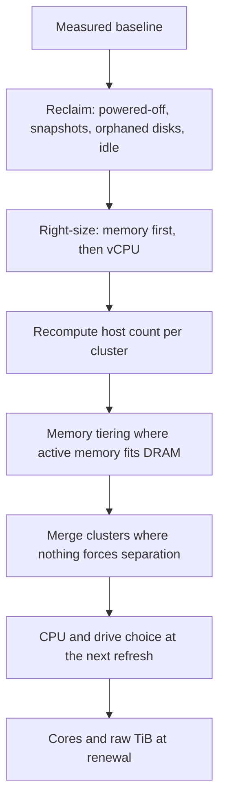

<InShort>
Most optimisation proposals fail review for the same reason: the number at the bottom cannot be traced back to anything. A cost case that holds up has four parts. A **baseline** measured from the estate. **Levers applied in order**, so the same capacity is not saved twice. An **assumptions table** that a reviewer can challenge line by line. And results shown at a **pessimistic** value next to the expected one. Express savings in cores, TiB and hosts first, then convert to money with the customer's own prices.
</InShort>

## The baseline

Take every figure from a system of record, not from memory or a slide.

| Figure | Where it comes from |
|---|---|
| Licensed cores and raw vSAN TiB | VCF Operations licence usage, or the counting script (<KB id={313548} />) |
| Hosts per cluster and what each cluster runs out of first | VCF Operations capacity, time remaining per resource |
| Allocated and active memory per cluster | VCF Operations, or MTAT for a tiering assessment |
| Reclaimable capacity by category | Capacity > Reclaim, potential savings |
| Oversized and undersized VMs | Optimisation reports |
| Hands-on hours for recurring tasks | Change records |

Record the date and the history window for each figure. A right-sizing result based on six weeks of data needs to say so.

## Apply the levers in order

Each lever changes the input to the next. Reclaiming an idle VM removes memory that right-sizing would otherwise also count, and memory tiering sized before right-sizing will be sized for waste. Applying them in a fixed order stops double counting.

Recompute the host count after each step, with the failover reserve included. The result of each step is a host count, a licensed core count and a raw TiB figure. Money comes last.

## The assumptions table

Every number in the case that is not measured is an assumption. Write them down where the reviewer can see them, with the source and the value you would use if you were wrong in the unhelpful direction.

| Assumption | Expected | Pessimistic | Basis |
|---|---|---|---|
| Active memory share | Measured | Measured plus 10 points | MTAT, 30 days including month-end |
| vSAN data reduction | Measured | 1.0:1 | Capacity view on a comparable cluster |
| Share of oversized memory that owners agree to remove | From a pilot with a few owners | Half the pilot figure | Pilot results |
| Free raw capacity kept | 30% | 30% | Design standard |
| Per-core price | From quote | From quote | Reseller quote, dated |

## Show both results

Present the pessimistic result first. If the change is still worth doing on pessimistic assumptions, the decision is easy. If it is only worth doing on expected assumptions, say so, and say what measurement would settle it. The [memory tiering example](/vcf/library/value/nvme-memory-tiering/) shows the pattern: a three-host saving on measured active memory of 25%, with a check that the design still holds with a host failed.

## One-time costs and timing

Savings in a VCF estate arrive at specific events. Core counts fall at renewal or when hosts leave the estate. Raw TiB falls at the next storage purchase. Set against them the one-time costs: NVMe devices for tiering, migration effort to merge clusters, engineering time for right-sizing reviews, and any change to third-party licences that follow cluster boundaries. A case that shows savings in the year they land is more credible than one that annualises everything from day one.

## Using vendor figures

Broadcom quotes up to 40% lower total cost of ownership for memory tiering and publishes benchmark overheads. Partners publish models with their own price assumptions, such as WWT's comparison at roughly 40 US dollars per GB of DRAM and 1 dollar per GB of NVMe in early 2026. These are useful for deciding whether to investigate. They are not evidence for a specific estate. Cite them as context and build the case from your own baseline.

<Callout title="A note on these examples">
Every worked example in this section is constructed to show the arithmetic. None of them describe a real estate or customer. The method is the part to reuse. See also [decisions with evidence](/vcf/library/leadership/decisions-with-evidence/) for how to write the recommendation itself.
</Callout>
