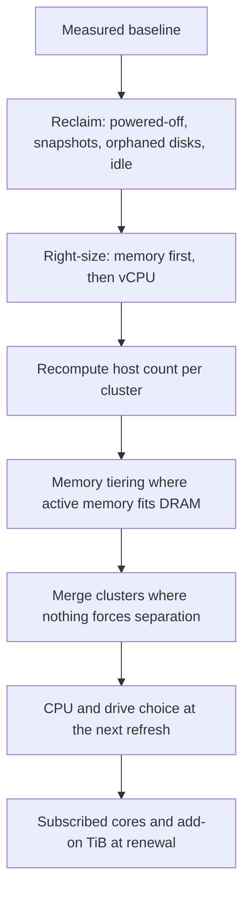

<InShort>
A cost case holds up when every saving traces to a dated measurement or a written assumption. Measure a baseline in VCF Operations, apply the levers in a fixed order so nothing is saved twice, and show the pessimistic result first. State savings in hosts, cores and TiB, then convert with your own quote. Date each saving too: core usage drops when hosts leave, subscribed capacity falls on a subscription's end date, and every VCF core you drop takes 1 TiB of included vSAN with it.
</InShort>

<Callout type="note" title="Corrected on 7 November 2026">
This note gave the reclaim path as Capacity > Reclaim, called the 25% in the tiering example measured, and said core counts fall at renewal or when hosts leave and raw TiB falls at the next storage purchase. On 9.1 the path is Manage > Capacity > Optimize, the example is constructed, usage and subscribed capacity can fall at different times, and the KB counting script lists only pre-9 environments.
</Callout>

## When a saving reaches the bill

Date each saving before totalling anything, because a change's costs and its licence effect can land in different years. [Only ESX hosts use primary licence capacity](https://techdocs.broadcom.com/us/en/vmware-cis/vcf/vcf-9-0-and-later/9-1/licensing/licensing-overview/licensing-model.html), counted in physical cores with a minimum of 16 per CPU on most products, so core usage drops when a host leaves. Subscribed capacity is a separate number, and the same page has it [reducing on the end date of each subscription](https://techdocs.broadcom.com/us/en/vmware-cis/vcf/vcf-9-0-and-later/9-1/licensing/licensing-overview/licensing-model.html) <AsOf date="2026-11-07" />. A host retired mid-term therefore frees room for growth, and whether it also cuts cost before that date is a question for your contract. That's an inference from the licensing page, and it isn't legal or purchasing advice.

Cores and TiB can't be saved independently. VCF [includes 1 TiB of vSAN per core](https://techdocs.broadcom.com/us/en/vmware-cis/vcf/vcf-9-0-and-later/9-1/licensing/licensing-overview/licensing-model.html), and add-on TiB pool with it: Broadcom's example is 300 cores plus a 50 TiB add-on, giving 350 TiB. Take that example and remove 60 cores in a constructed consolidation. Capacity falls to 290 TiB, so an estate with 320 TiB raw is now 30 TiB short and would have to buy back part of what it saved. It follows that reducing raw TiB changes the licence bill only where raw exceeds what's included. Below that line, fewer drives are a hardware saving at the next storage purchase.

Set the one-time costs against those dates: NVMe devices for tiering, migration effort to merge clusters, engineering time for right-sizing reviews, [workload restarts that may interrupt work](https://techdocs.broadcom.com/us/en/vmware-cis/vcf/vcf-9-0-and-later/9-1/cost-and-capacity-management/optimizing-capacity-and-improving-performance/how-to-optimize-capacity-and-improve-performance/using-rightsize-to-adjust-resource-allocation.html), and any change to third-party licences that follow cluster boundaries. Show each saving in the year it lands, since annualising everything from day one overstates the first year.

## The baseline

Take every figure from a system of record, with its date and history window beside it.

| Figure | Where it comes from |
|---|---|
| Licensed cores, 9.x | [Manage > Licensing > Usage Analytics](https://techdocs.broadcom.com/us/en/vmware-cis/vcf/vcf-9-0-and-later/9-1/licensing/license-usage-analytics/view-license-usage-per-product-in-vcf-operations.html), which also shows maximum usage by month or day. On 9.1 the figure [includes 8.x hosts](https://techdocs.broadcom.com/us/en/vmware-cis/vcf/vcf-9-0-and-later/9-1/release-notes/vmware-cloud-foundation-9-1-0-0-release-notes/what-s-new/whats-new-vcf-ops.html) |
| Raw vSAN TiB, 9.x | That page doesn't mention vSAN or TiB, so use the raw figure in [The vSAN entitlement](/vcf/library/value/vsan-entitlement/) |
| Licensed cores and raw vSAN TiB, before 9 | The script in <KB id={313548} />, whose environment lists VCF 4.5 and 5.1 and ESXi to 8.0. It needs PowerCLI 13.3 and PowerShell 7.4.6 or later, and the KB warns against counting vSAN TiB by hand from the UI |
| Hosts per cluster and what each cluster runs out of first | VCF Operations capacity, time remaining per resource |
| Allocated and active memory per cluster | VCF Operations, or [MTAT](https://blogs.vmware.com/cloud-foundation/2026/07/31/meet-mtat-your-zero-friction-path-to-memory-tiering-in-vmware-cloud-foundation-9-0/) for a tiering assessment, from vCenter history. Full history needs Statistical Level 2 or higher |
| Reclaimable CPU, memory and disk, with monthly potential savings per category | [Manage > Capacity > Optimize](https://techdocs.broadcom.com/us/en/vmware-cis/vcf/vcf-9-0-and-later/9-1/cost-and-capacity-management/optimizing-capacity-and-improving-performance/how-to-optimize-capacity-and-improve-performance/using-reclaim-to-free-up-resources.html), then a data center |
| Oversized and undersized VMs | [The Rightsize tab](https://techdocs.broadcom.com/us/en/vmware-cis/vcf/vcf-9-0-and-later/9-1/cost-and-capacity-management/optimizing-capacity-and-improving-performance/how-to-optimize-capacity-and-improve-performance/using-rightsize-to-adjust-resource-allocation.html) on the same page, with one to 12 months of history |
| Savings already achieved | The [Reclamation Dashboard](https://techdocs.broadcom.com/us/en/vmware-cis/vcf/vcf-9-0-and-later/9-1/release-notes/vmware-cloud-foundation-9-1-0-0-release-notes/what-s-new/whats-new-vcf-ops.html), listed in the 9.1 release notes |
| Hands-on hours for recurring tasks | Change records |

Three things move these figures, so write them next to the numbers. Reclaim calculations [use the demand model by default and the allocation model if the policy enables it](https://techdocs.broadcom.com/us/en/vmware-cis/vcf/vcf-9-0-and-later/9-1/cost-and-capacity-management/optimizing-capacity-and-improving-performance/how-to-optimize-capacity-and-improve-performance/using-reclaim-to-free-up-resources.html), and a legend above the table shows which applies. Right-sizing recommendations [follow the policy's risk level](https://techdocs.broadcom.com/us/en/vmware-cis/vcf/vcf-9-0-and-later/9-1/cost-and-capacity-management/optimizing-capacity-and-improving-performance/how-to-optimize-capacity-and-improve-performance/using-rightsize-to-adjust-resource-allocation.html). The upgrade to 9.1.1 moves capacity forecasts to a time-decay regression over up to 90 days, which [may slightly shift rightsizing and time remaining](https://blogs.vmware.com/cloud-foundation/2026/10/20/a-smarter-more-transparent-way-to-forecast-capacity-in-vcf/), as Kelcey Lemon explains. Reconcile a baseline taken before that upgrade against the comparison file it writes to `/storage/log/vcops/log/capacityMetricsUpgradeChanges.csv`.

Use the potential savings figures in the Reclaim view to rank work. The Reclaim page gives neither formula nor rates. [Global Settings multiplies a storage rate by the reclaimable storage](https://techdocs.broadcom.com/us/en/vmware-cis/vcf/vcf-9-0-and-later/9-1/infrastructure-operations/-configuring-administration-settings/modifying-global-settings/list-of-global-settings.html) for powered-off VMs and snapshots but publishes no rate, so take the capacity numbers into the case and price them from your quote.

## Apply the levers in order

<Callout type="analysis" title="Why this order">
Each lever changes the input to the next. Reclaiming an idle VM removes memory that right-sizing would otherwise also count, and tiering sized before right-sizing is sized for waste. Broadcom's [9.1 design blueprint index](https://techdocs.broadcom.com/us/en/vmware-cis/vcf/vcf-9-0-and-later/9-1/design/design-blueprints-for.html) has no entry on cost or capacity (checked 7 Nov 2026), so this sequence is this site's method and yours to challenge.
</Callout>

The tooling makes double counting easy, so don't add its totals together. The `Cost|Potential Savings` metric [combines oversized and reclaimable savings for a VM](https://blogs.vmware.com/cloud-foundation/2025/08/12/vmware-cloud-foundation-helps-you-optimally-size-vms-and-keep-your-infrastructure-and-workloads-running-smoothly/), Lemon's August 2025 post says, and on 9.1 a VM that qualifies several ways [appears in each matching reclaim section](https://techdocs.broadcom.com/us/en/vmware-cis/vcf/vcf-9-0-and-later/9-1/cost-and-capacity-management/optimizing-capacity-and-improving-performance/how-to-optimize-capacity-and-improve-performance/using-reclaim-to-free-up-resources.html). Summing those sections could count one VM twice, which is an inference Broadcom doesn't state. Work from the VM lists and assign each VM to one action.

Recompute the host count after each step, with the failover reserve included. Each step should end in a host count, a licensed core count and a raw TiB figure, with money added last.

## The assumptions table

Any number in the case that isn't measured is an assumption, and a reviewer should be able to see it with its basis and its value if you're wrong in the unhelpful direction. The pessimistic values below are this site's starting points, so change them and write down why.

| Assumption | Expected | Pessimistic | Basis |
|---|---|---|---|
| Active memory share | Measured | Measured plus 10 points | [MTAT](https://blogs.vmware.com/cloud-foundation/2026/07/31/meet-mtat-your-zero-friction-path-to-memory-tiering-in-vmware-cloud-foundation-9-0/) 30-day window, placed to span your month-end if batch work runs then |
| vSAN data reduction | Measured | 1.0:1 | Capacity view on a comparable cluster |
| Share of oversized memory that owners agree to remove | From a pilot with a few owners | Half the pilot figure | Pilot results |
| Free raw capacity kept | 30% | 30% | This section's planning figure, worked in [the ESA space note](/vcf/library/value/vsan-esa-space-efficiency/). Use your own design standard if it differs |
| Per-core price | From quote | From quote | Reseller quote, dated |

## Show both results

Lead with the pessimistic result. If the change is still worth doing there, the decision is easy. If it only works on expected assumptions, say so and name the measurement that would settle it. The constructed [memory tiering example](/vcf/library/value/nvme-memory-tiering/) shows why: it removes 3 of 8 hosts at 25% active, 1 at 50%, none above 51%, and costs an extra host at 60%, with every row checked against a failed host. A case built on that lever stands or falls on the measured active share, so measure it before pricing anything.

## Using vendor figures

Vendor numbers can justify an investigation, but they aren't evidence for a specific estate. Broadcom's "up to 40%" lower total cost of ownership for tiering is the clearest case, because the same figure comes with two different mechanisms: [reduced DRAM requirements](https://blogs.vmware.com/cloud-foundation/2025/07/17/memory-tiering-performance-in-vmware-cloud-foundation-9-0/) in the July 2025 performance post by Todd Muirhead and Qasim Ali, and [better consolidation ratios](https://blogs.vmware.com/cloud-foundation/2026/05/07/advanced-memory-tiering-enhancements-in-vmware-cloud-foundation-9-1/) in Dave Morera's May 2026 post. Fewer DIMMs and fewer licensed hosts are different bills, so your case has to say which one it claims. The July post's benchmark losses on 9.0 are more useful for a pessimistic case: 0 to 8% on Login Enterprise and 5 to 10% on HammerDB.

Partner models carry their own prices. WWT, which lists VMware as a strategic partner, [assumes about $40 per GB of DDR5 and $1 per GB of NVMe](https://www.wwt.com/blog/memory-tiering-in-vmware-cloud-foundation-9-a-closer-look-at-the-tco-equation) in March 2026, and gets $39,000 less memory cost per host by comparing 2 TB of DRAM with 1 TB of DRAM plus 1 TB of NVMe. Replace those prices with your quote. MTAT's Sizing and TCO section is also [an estimate for planning](https://blogs.vmware.com/cloud-foundation/2026/07/31/meet-mtat-your-zero-friction-path-to-memory-tiering-in-vmware-cloud-foundation-9-0/), with no formal quote behind it. The [cost claims ledger](/vcf/library/value/cost-claims-ledger/) sets the wider range of vendor figures side by side.

<Callout title="A note on these examples">
Every worked example in this section is constructed to show the arithmetic. None of them describe a real estate or customer. The method is the part to reuse. See also [decisions with evidence](/vcf/library/leadership/decisions-with-evidence/) for how to write the recommendation itself.
</Callout>
