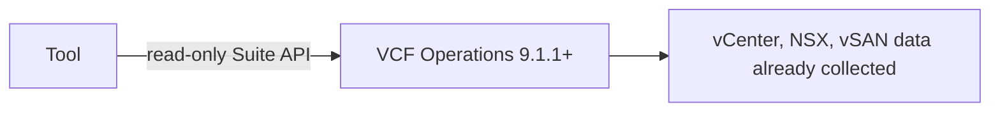

---
# Project page template. Copy to src/content/projects/<slug>.mdx, where <slug> matches the repo
# <slug>-for-vcf-operations and the slug in its project.json. Set draft: false to publish.
# Version, compatibility, permissions and links come from the repo's release project.json
# (npm run sync:projects). The fields below are used until the first release exists.
displayName: "Template Tool for VCF Operations"
summary: "One sentence that says what the tool does and who it is for."
kind: "script"
status: "In development"
pubDate: 2026-11-02
repo: "djoleradikod/vcf-operations-tool-template"
# cover: ./img/template-tool.png      # 1200x630 screenshot, shown on cards and at the top of the page
# coverAlt: "What the screenshot shows"
# youtube: "VIDEO_ID"                 # optional demo video
draft: true
---

## What it does

Two or three sentences on the problem it solves in a VCF estate, in the reader's terms.

## How it works

## Install

<Steps>
1. Download the latest release from GitHub.
2. Import or run it as the README describes.
3. Confirm it works: what the user should see.
</Steps>
