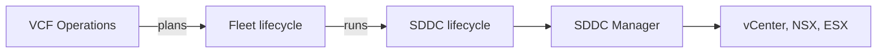

import { Code } from 'astro:components';
import Img from '../../components/Img.astro';
import Gallery from '../../components/Gallery.astro';
import Video from '../../components/Video.astro';
import Download from '../../components/Download.astro';
import Pdf from '../../components/Pdf.astro';
import Mermaid from '../../components/Mermaid.astro';
import Callout from '../../components/Callout.astro';
import Steps from '../../components/Steps.astro';
import Compare from '../../components/Compare.astro';
import KB from '../../components/KB.astro';
import cardA from '../../assets/guide/sample-card.png';
import cardB from '../../assets/guide/sample-card-2.png';
import cardC from '../../assets/guide/sample-card-3.png';
import poster from '../../assets/guide/sample-poster.png';

## Where things go

| Content | Put it in | Published as |
|---|---|---|
| VCF note | `src/content/articles/<category>/<slug>.mdx` | `/vcf/library/<category>/<slug>/` |
| Blog post, case study | `src/content/posts/<slug>.mdx` | `/blog/<slug>/` |
| Tool page | `src/content/projects/<slug>.mdx` | `/projects/<slug>/`, facts from the repo's `project.json` |
| Screenshots, diagrams as images | next to the MDX file, e.g. `./img/console.png` | AVIF and WebP at several widths, zoomable |
| Scripts, PDFs, small files | `public/downloads/...` | as-is, with size and SHA-256 shown |
| Videos, large files | `media/...` (not in git) | `/media/...` on Hetzner, or `PUBLIC_MEDIA_URL` |

All components below work in any `.mdx` file in the content folders without importing them. Images must be imported (or written as Markdown images with a relative path).

## Images


<Code themes={{ light: 'github-light-high-contrast', dark: 'github-dark-high-contrast' }} lang="mdx" code={`import shot from './img/console.png';


          // breaks out of the text column
              // plain Markdown also works and is zoomable`} />

## Galleries

<Gallery caption="Screens that belong together" items={[
  { src: cardA, alt: 'Cheat sheet share card', caption: 'Cheat sheet' },
  { src: cardB, alt: 'Triage note share card', caption: 'Triage note' },
  { src: cardC, alt: 'Projects share card', caption: 'Projects' },
]} />

## Video

Self-hosted, with poster and captions. Only the poster loads until the reader presses play.

<Video title="Sample clip" sources={['/downloads/guide/sample.webm', '/downloads/guide/sample.mp4']} poster={poster} captions="/downloads/guide/sample.en.vtt" caption="Self-hosted video with English captions." />

<Code themes={{ light: 'github-light-high-contrast', dark: 'github-dark-high-contrast' }} lang="mdx" code={`<Video title="Upgrade walkthrough" src="video/upgrade-walkthrough" poster={posterImg} captions="video/upgrade.en.vtt" />
// looks for media/video/upgrade-walkthrough.webm and .mp4

<Video title="Talk recording" youtube="VIDEO_ID" duration="42 min" />
// nothing loads from YouTube until play; then the privacy-enhanced player`} />

## Diagrams

Mermaid for flows that change often; hand-drawn SVG (the `Diagram` component) for architecture pictures.



<Code themes={{ light: 'github-light-high-contrast', dark: 'github-dark-high-contrast' }} lang="md" code={'```mermaid\nflowchart LR\n  A[Start] --> B{Check}\n  B -- yes --> C[Done]\n```'} />

## Scripts and files

<Download file="/downloads/vcf/vcf-check-basics.sh" title="vcf-check-basics.sh" description="Read-only DNS and reachability pre-flight." license="MIT" source />

<Code themes={{ light: 'github-light-high-contrast', dark: 'github-dark-high-contrast' }} lang="mdx" code={`<Download file="/downloads/vcf/vcf-check-basics.sh" description="..." license="MIT" source />`} />

## PDFs

<Pdf file="/downloads/vcf/vcf9-triage-cheat-sheet.pdf" title="VCF 9.x triage cheat sheet (A4)" />

<Code themes={{ light: 'github-light-high-contrast', dark: 'github-dark-high-contrast' }} lang="mdx" code={`<Pdf file="/downloads/vcf/vcf9-triage-cheat-sheet.pdf" title="..." />
// regenerate site PDFs: npm run build && npm run pdfs && npm run build`} />

## Procedures, comparisons, call-outs, KBs

<Steps>
1. Take a backup of SDDC Manager.
2. Run the precheck and fix what it reports.
3. Start the upgrade in the maintenance window.
</Steps>

<Compare rows={[["Where upgrades start", "SDDC Manager", "VCF Operations, Build > Lifecycle"]]} />

<Callout type="field">From the field: the precheck that passes on Monday can fail on Friday. Run it again on the day.</Callout>

A KB reference renders as a link with its topic: <KB id={440630} />.
